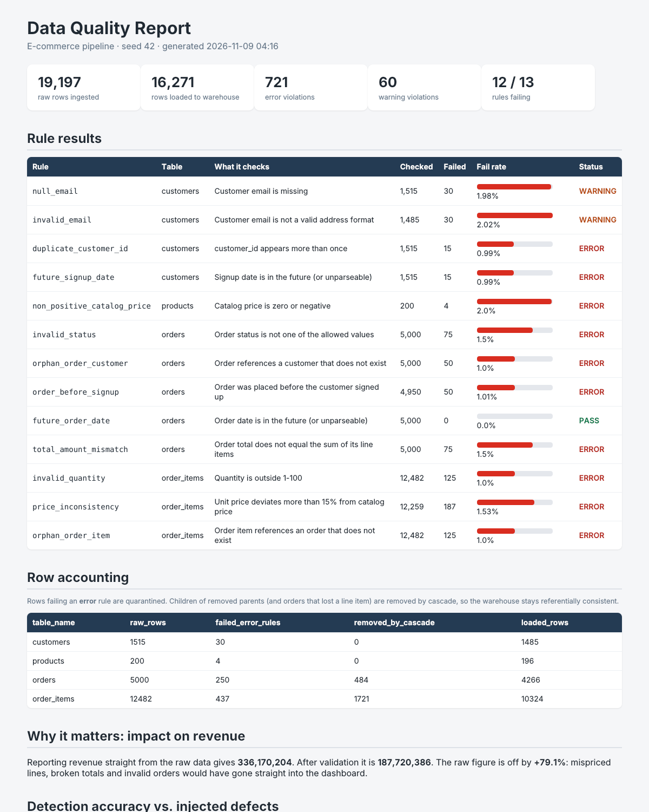
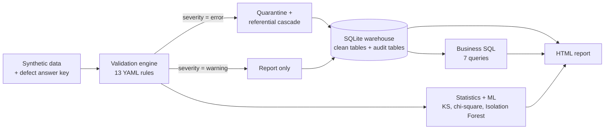
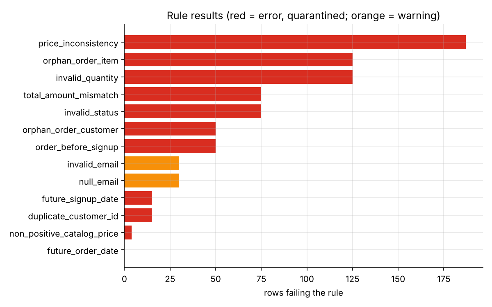
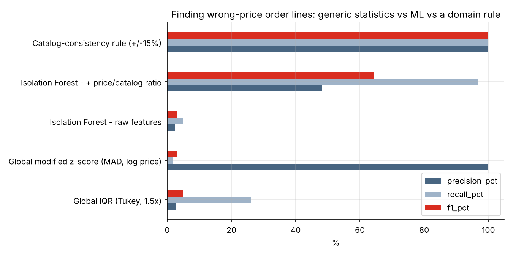
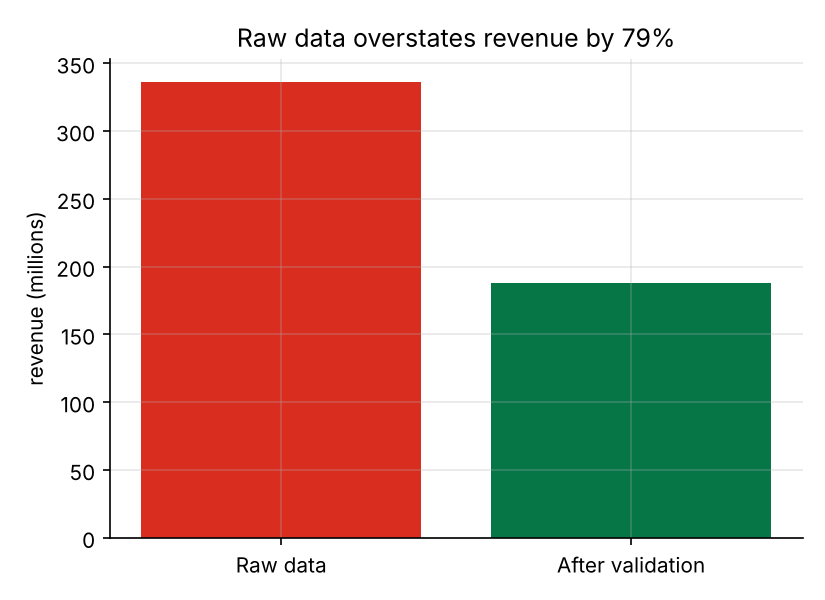

# E-commerce Data Quality & Validation Pipeline

[](https://github.com/pransData12/ecommerce-data-quality-pipeline/actions/workflows/ci.yml)


**Detect, quarantine and quantify bad data before it reaches analytics.** A Python pipeline that combines
config-driven validation rules, statistics (KS test, chi-square) and machine learning (Isolation Forest), and **scores itself
against a known answer key** instead of just "looking right".

> **Headline results (seed 42)**
> - Revenue computed straight from the raw data is **overstated by 79%** (336.2M vs 187.7M after validation).
> - The 13 rules find **all 12 injected defect types: 100% recall, 100% precision**.
> - The loaded warehouse passes re-validation with **zero error-severity failures**.
> - A global IQR outlier test finds wrong prices with **2.6% precision**; comparing each price to its own product's catalog price is exact.



## Contents
[The problem](#the-problem) · [Architecture](#architecture) · [Quick start](#quick-start) · [What each stage does](#what-each-stage-does) ·
[Results](#results) · [Design decisions](#design-decisions) · [Adding rules](#adding-or-changing-rules) · [Using other data](#using-other-data) ·
[Tests and CI](#tests-and-ci) · [Limitations](#limitations) · [Project layout](#project-layout)

## The problem

Bad data rarely fails loudly. A duplicated customer, an order total that does not match its line items, or a price entered
ten times too high silently flows into dashboards and models. Real dirty data also comes with no answer key, so nobody
knows how much a validator *missed*.

This project solves both parts: it generates e-commerce data with **12 kinds of defects injected at known rows**, validates it,
and measures precision and recall per rule.

## Architecture



## Quick start

```bash
git clone https://github.com/pransData12/ecommerce-data-quality-pipeline.git
cd ecommerce-data-quality-pipeline

python -m venv .venv && source .venv/bin/activate      # Windows: .venv\Scripts\activate
pip install -r requirements-dev.txt

python -m dq_pipeline            # generate data -> validate -> load warehouse -> write report
open reports/dq_report.html      # macOS; on Windows/Linux just open the file in a browser
python -m pytest -q              # 21 tests
```

Prefer a notebook? Open [`notebooks/Project1_Data_Quality_Pipeline.ipynb`](notebooks/Project1_Data_Quality_Pipeline.ipynb):
the whole project in one runnable, explained file (needs `pip install jupyter`).

Options: `--seed N` · `--skip-generate` (reuse CSVs already in `--data-dir`) · `--config` · `--db` · `--report` ·
`--strict` (exit code 1 if any error-severity rule fails, useful as a CI gate). `make run`, `make test`, `make figures` also work.

A small sample of the raw (dirty) data is in [`data/sample/`](data/sample/); the full data is regenerated on every run.

## What each stage does

| Stage | File | What happens |
|---|---|---|
| 1. Generate | `dq_pipeline/generate_data.py` | Builds consistent customers, products, orders and order items, then injects 12 defect types at *disjoint* rows and logs each one. |
| 2. Validate | `dq_pipeline/validators.py`, `config/rules.yaml` | 13 rules (nulls, uniqueness, regex, ranges, allowed values, foreign keys, date logic, price and total consistency). Scores recall/precision per rule. |
| 3. Quarantine and load | `dq_pipeline/warehouse.py` | Error rows are held back, children of removed parents are cascaded out, an order that lost a line item is removed too. Clean tables plus `dq_violations`, `dq_rule_results`, `dq_row_accounting` go into SQLite. |
| 4. Business SQL | `sql/business_queries.sql` | Monthly revenue, month-over-month growth (`LAG`), revenue by category, top customers (`RANK`), repeat-customer rate, cancel/return rate by country. |
| 5. Statistics and ML | `dq_pipeline/stats_ml.py` | Column profiling, KS and chi-square drift tests with effect sizes, Isolation Forest, comparison against IQR and MAD z-score. |
| 6. Report | `dq_pipeline/report.py` | One self-contained HTML file: rule table, row accounting, revenue impact, detection accuracy, SQL answers, sample bad rows. |

## Results

Seed 42; 19,197 raw rows (1,515 customers · 200 products · 5,000 orders · 12,482 order items); 16,271 rows loaded.

**1. Rules vs. the answer key.** Every injected defect type is detected with no false alarms.



**2. Finding wrong-price order lines: which method works?**



| Method | Flagged | Precision | Recall | F1 |
|---|---|---|---|---|
| Global IQR (Tukey 1.5x) | 1,873 | 2.6% | 26.2% | 4.8% |
| Global modified z-score (MAD, log price) | 3 | 100% | 1.6% | 3.2% |
| Isolation Forest, raw features | 375 | 2.4% | 4.8% | 3.2% |
| Isolation Forest, + price/catalog ratio | 375 | 48.3% | 96.8% | 64.4% |
| Catalog-consistency rule (±15%) | 187 | 100% | 100% | 100% |

**3. What can ML see on its own?** Isolation Forest recall by defect type: wrong prices 96.8%, invalid quantities 7.2%,
orphan keys 1.6%. Value anomalies are visible to ML; structural defects (broken foreign keys) are not. Rules and ML are complementary.

**4. What the dirty data would have cost.**



**5. Did cleaning distort the data?** KS statistics for `unit_price`, `quantity` and `total_amount` are 0.008 to 0.017 (practically
identical). Only order `status` shifts (Cramér's V 0.08) because invalid labels were removed. Cleaning removed corrupt rows,
not a real customer segment.

## Design decisions

1. **An answer key instead of eyeballing.** Defects touch disjoint rows, order totals are recomputed after item defects, and
   future-dated signups only hit customers without orders, so one defect never secretly causes another and distorts the scores.
2. **Catalog-price consistency instead of IQR outliers.** A normal Electronics price (up to 90,000) looks like an outlier next
   to Books (150 to 1,500), and a wrong Books price looks normal among Electronics. A global test cannot know that; the catalog can.
3. **Rules plus ML, not either/or.** Rules are precise and explainable but only catch what someone thought of. Isolation Forest
   can surface unnamed anomalies but needed a domain feature (price/catalog ratio) to work (4.8% recall without it, 96.8% with it)
   and cannot see broken keys.
4. **Errors quarantine, warnings report.** A malformed email does not corrupt revenue, so it is a warning.
5. **Cascade quarantine.** If a line item is bad, its order's total can no longer be trusted, so the whole order is held back.
   That is why re-validating the warehouse gives zero error failures.
6. **Plug-in checks.** A new check type is one decorated function; `rules.yaml` needs no other code change.

## Adding or changing rules

Rules are YAML, not code. See [`docs/rules_reference.md`](docs/rules_reference.md) for every check type, its parameters,
and a worked example of adding a brand-new check type.

## Using other data

The pipeline expects the four tables in `data/raw/` (`customers`, `products`, `orders`, `order_items`) with the columns used by
`config/rules.yaml`. To try it on a real dataset with a similar shape (for example the public Olist Brazilian e-commerce
dataset), rename its columns to match, put the CSVs in a folder, and run
`python -m dq_pipeline --data-dir path/to/folder --skip-generate`. Without the injected-defect answer key the report skips the
precision/recall section. For a different schema, change `TABLE_NAMES` in `run_pipeline.py` and edit the rules.

## Tests and CI

`python -m pytest -q` runs 21 tests:
- unit tests for each check type on tiny hand-made frames with known answers,
- an end-to-end test requiring 100% recall and precision against the answer key,
- a test that re-validates the loaded SQLite warehouse and expects zero error failures,
- row-accounting, determinism (same seed gives byte-identical CSVs) and ML reproducibility tests.

GitHub Actions ([`.github/workflows/ci.yml`](.github/workflows/ci.yml)) runs the tests and the full pipeline on Python 3.11 and 3.12
for every push and pull request, and uploads the HTML report as a build artifact.

## Limitations

- **The data is synthetic.** The 100% numbers show the validator works as designed, not that it would catch everything in
  production. Real data has defects nobody injected.
- Isolation Forest uses `contamination=0.03`, an assumption about the defect rate. On real data you would tune it or use a score
  threshold and review flagged rows by hand.
- The 79% revenue inflation is large because the injected 10x prices and 500-unit quantities are extreme by design.
- Everything runs in memory with pandas; at millions of rows push the checks into SQL or use a framework such as Great Expectations.

## Ideas to extend

- Add a `freshness` or `distribution_shift` check type and rules for it.
- Fail a run when the KS statistic against a baseline batch exceeds a threshold (drift gate).
- Compare Local Outlier Factor and One-Class SVM with Isolation Forest.
- Keep run history in a table and trend the failure rates over time.
- A small Streamlit page that reads `warehouse/ecommerce.db`.

## Project layout

```
.github/workflows/ci.yml      tests + full pipeline run on every push
config/rules.yaml             the 13 validation rules (edit this, not the code)
data/sample/                  100-row samples of each raw table
docs/                         figures used in this README + rules_reference.md
dq_pipeline/                  generate_data, validators, warehouse, stats_ml, report, run_pipeline
notebooks/                    the whole project as one explained Jupyter notebook
scripts/make_figures.py       regenerates docs/*.png from a real run
sql/business_queries.sql      named SQL queries run on the clean warehouse
tests/                        pytest: unit tests + end-to-end tests scored vs ground truth
```

## License

MIT, see [LICENSE](LICENSE).
